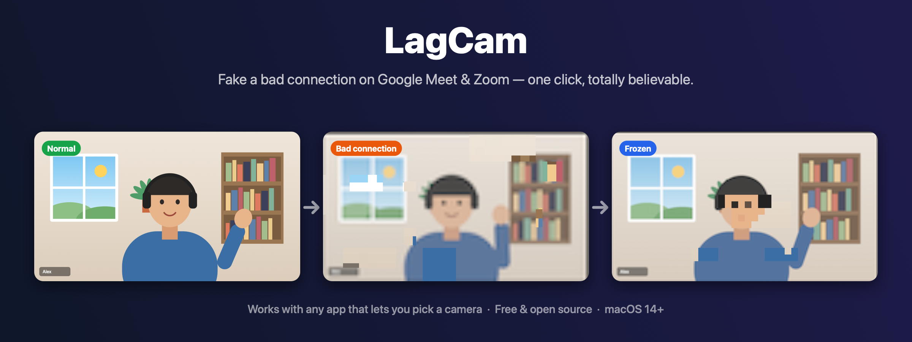
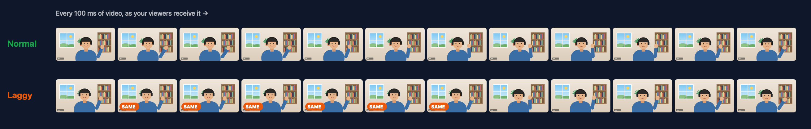
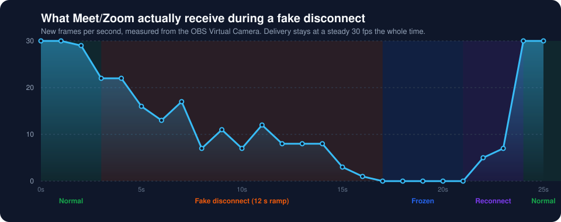
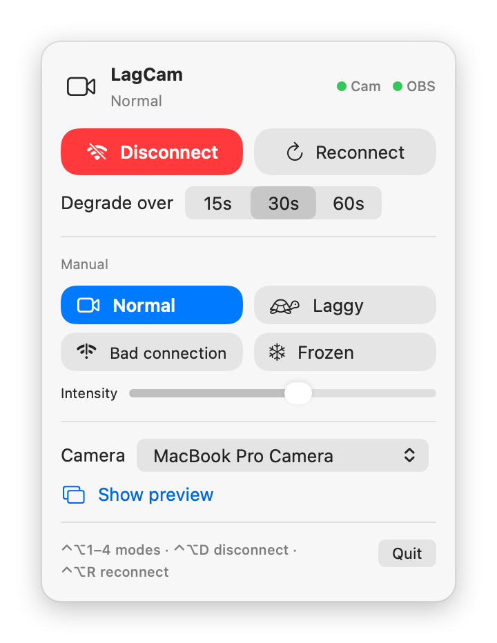
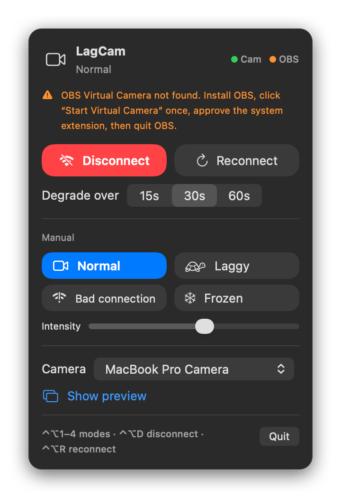
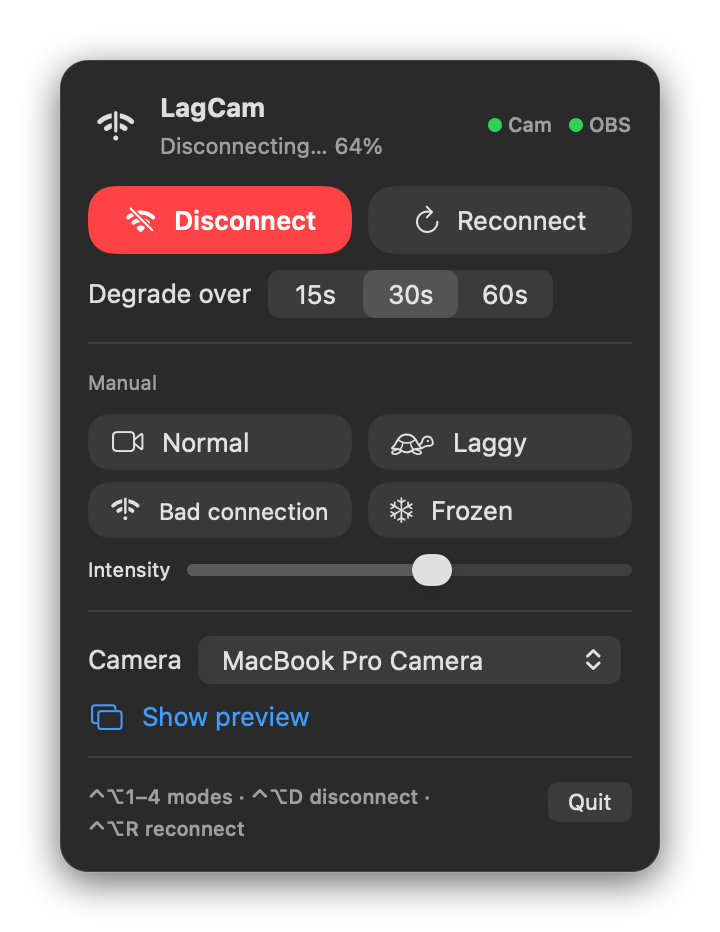
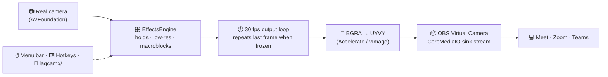

<div align="center">



# LagCam

**Make your webcam look like your internet is dying, on purpose.**

A free, open-source macOS menu-bar app that makes your camera feed in **Google Meet, Zoom, Microsoft Teams, Slack, Discord, FaceTime** and any other video app lag, break into blocks and finally freeze, exactly like a real bad connection.

[](https://github.com/iPrakharV/LagCam/releases/latest)
[](#-requirements)
[](https://swift.org)
[](#-requirements)
[](LICENSE)

[**Download**](https://github.com/iPrakharV/LagCam/releases/latest) · [Install guide](#-installation) · [How to use](#-quick-start) · [Troubleshooting](#-troubleshooting) · [FAQ](#-faq)

</div>

---

## 📖 Table of contents

- [What is LagCam?](#-what-is-lagcam)
- [Features](#-features)
- [See it in action](#-see-it-in-action)
- [Requirements](#-requirements)
- [Installation](#-installation)
  - [Step 1: Set up the OBS virtual camera (one time)](#step-1--set-up-the-obs-virtual-camera-one-time)
  - [Step 2: Install LagCam](#step-2--install-lagcam)
  - [Step 3: First launch & camera permission](#step-3--first-launch--camera-permission)
- [Quick start (60 seconds)](#-quick-start)
- [Selecting the camera in Meet, Zoom, Teams & more](#-selecting-the-camera-in-your-meeting-app)
- [The menu, explained](#-the-menu-explained)
- [Effect modes](#-effect-modes)
- [Keyboard shortcuts](#%EF%B8%8F-keyboard-shortcuts)
- [Automation with `lagcam://` links](#-automation-with-lagcam-links)
- [Tips for a convincing performance](#-tips-for-a-convincing-performance)
- [Troubleshooting](#-troubleshooting)
- [FAQ](#-faq)
- [Privacy](#-privacy)
- [How it works](#%EF%B8%8F-how-it-works)
- [Building from source](#%EF%B8%8F-building-from-source)
- [Uninstalling](#%EF%B8%8F-uninstalling)
- [Roadmap](#%EF%B8%8F-roadmap)
- [Feedback](#-feedback)
- [License & credits](#-license--credits)

---

## 🤔 What is LagCam?

You know that moment on a video call when someone's picture gets choppy, turns into a blurry mess of blocks, freezes mid-sentence, and then they're gone? **LagCam lets you produce that moment yourself with one click.**

LagCam sits between your real webcam and your meeting app:

```
Your webcam  ──►  LagCam (adds the effects)  ──►  "OBS Virtual Camera"  ──►  Meet / Zoom / Teams / …
```

In your meeting app you pick **OBS Virtual Camera** instead of your normal webcam. While LagCam is set to *Normal*, people just see you as usual, in full quality and smooth. When you want to "lose connection", click **Disconnect** (or press **⌃⌥D**) and your video gets worse over 15–60 seconds until it freezes on a single frame.

It isn't a cheap filter. The effects copy what real video codecs do on a failing network: dropped frames, falling resolution, corrupted macroblocks, and pieces of old frames stuck on screen.

---

## ✨ Features

| | Feature | Details |
|---|---|---|
| 📉 | **One-click fake disconnect** | Smooth → choppy → blocky and smeared → frozen, over **15, 30 or 60 seconds**, with natural randomness. |
| 🔁 | **Reconnect** | Stays frozen for a moment, shows a few seconds of poor quality, then recovers smoothly. |
| 🎛️ | **Four manual modes** | **Normal**, **Laggy**, **Bad connection**, **Frozen**. Hold any of them for as long as you like. |
| 🎚️ | **Intensity slider** | From "slightly unstable Wi-Fi" to "calling from a submarine". |
| ⌨️ | **Global hotkeys** | Trigger everything without leaving Meet or Zoom. No Accessibility permission needed. |
| 🔗 | **`lagcam://` URL commands** | Automate it with Shortcuts, Raycast, Alfred, Stream Deck, or Terminal. |
| 🧊 | **Realistic freeze** | Keeps streaming the frozen frame, so the meeting app **never** shows a "camera not working" error. You just look frozen. |
| 👀 | **Live preview** | A preview window shows exactly what other people see. |
| 🖥️ | **Lives in the menu bar** | No Dock icon, nothing on screen while you share it. |
| 🔒 | **100% local** | No network access, no accounts, no analytics. |
| 🆓 | **Free & open source** | MIT licensed. No paid Apple developer account needed to use it. |

---

## 🎬 See it in action

### The three looks

<table>
  <tr>
    <th align="center">✅ Normal</th>
    <th align="center">📶 Bad connection</th>
    <th align="center">🧊 Frozen</th>
  </tr>
  <tr>
    <td></td>
    <td></td>
    <td></td>
  </tr>
  <tr>
    <td align="center"><sub>Full quality, 30 fps. What people see most of the time.</sub></td>
    <td align="center"><sub>Low resolution, washed-out color, macroblocks, stale patches.</sub></td>
    <td align="center"><sub>Stuck on one frame, ideally mid-blink.</sub></td>
  </tr>
</table>

> The images above use a generated demo scene. They're produced by LagCam's real effects engine, so this is exactly what the effects look like.

### Laggy: what viewers receive, frame by frame

When **Laggy** is active, LagCam stops sending new frames at random moments. Viewers see the same picture repeated, then a jump forward, just like real packet loss:



### A fake disconnect, measured

This chart uses real measurements taken by reading the **OBS Virtual Camera** the way Meet and Zoom do, during a 12-second fake disconnect followed by a reconnect:



The camera keeps **delivering 30 frames every second** the whole time. Only the number of *new* frames drops, so the meeting app sees a working camera with a terrible connection, not a broken camera.

### The menu-bar app

<div align="center">
<picture>
  <source media="(prefers-color-scheme: dark)" srcset="docs/images/menu-dark.png">
  <source media="(prefers-color-scheme: light)" srcset="docs/images/menu-light.png">
  
</picture>
</div>

---

## 📋 Requirements

| Requirement | Details |
|---|---|
| **macOS** | 14 Sonoma or newer (tested on macOS 27) |
| **Mac** | Apple Silicon (M1–M5) or Intel. The release is a universal app. |
| **A camera** | Built-in FaceTime camera, an external USB webcam, or an iPhone through Continuity Camera |
| **OBS Studio 30+** | Free. LagCam uses **only OBS's virtual camera driver** and you never need to open OBS while using LagCam. [Why?](#why-does-it-need-obs) |

---

## 📥 Installation

Setup takes about **5 minutes**, once. After that, you just open LagCam.

### Step 1: Set up the OBS virtual camera (one time)

LagCam sends its video through the **OBS Virtual Camera**, a camera driver that ships with OBS Studio and is already signed by Apple.

1. **Install OBS Studio.**
   - Download it from **[obsproject.com](https://obsproject.com/download)**, or
   - with [Homebrew](https://brew.sh):
     ```bash
     brew install --cask obs
     ```

2. **Open OBS.** If an *Auto-Configuration Wizard* appears, you can cancel it.

3. Click **Start Virtual Camera** in the *Controls* panel at the bottom right.

4. **Approve the camera extension.** macOS will say a system extension was blocked. This step is the one most people miss:
   - Open **System Settings → General → Login Items & Extensions**.
   - Scroll **all the way down** to the **Extensions** section.
   - Click the **ⓘ** next to **Camera Extensions**.
   - Turn on **OBS Virtual Camera** and click **Done**. Enter your password if asked.

   > 💡 On some macOS versions the prompt appears in **System Settings → Privacy & Security** instead, as *"System software from application 'OBS' was blocked from loading"*. Click **Allow** there.

5. Back in OBS, click **Stop Virtual Camera**, then **quit OBS** (⌘Q). The driver stays installed for good.

<details>
<summary><b>✅ Optional: check that the driver is enabled</b></summary>

Run this in Terminal:

```bash
systemextensionsctl list | grep -i obs
```

You want to see **`[activated enabled]`** at the end of the line.
If it says **`[activated waiting for user]`**, the switch in step 4 isn't turned on yet.

</details>

### Step 2: Install LagCam

1. Go to the **[latest release](https://github.com/iPrakharV/LagCam/releases/latest)** and download **`LagCam.zip`**.
2. Double-click the zip to unzip it.
3. Drag **`LagCam.app`** into your **Applications** folder.

### Step 3: First launch & camera permission

LagCam is free and isn't signed with a paid Apple Developer ID, so macOS shows a warning the first time you open it. This is expected.

1. Double-click **LagCam** in Applications. macOS says it *"cannot verify the developer"*. Click **Done** or **Cancel**.
2. Open **System Settings → Privacy & Security**, scroll down to the **Security** section, and click **Open Anyway** next to the LagCam message. Confirm with your password or Touch ID.
3. LagCam starts and a **📹 camera icon appears in your menu bar**.
4. When asked *"LagCam would like to access the camera"*, click **Allow**.

<details>
<summary><b>⌨️ Prefer Terminal? One command instead of steps 1–2</b></summary>

```bash
xattr -dr com.apple.quarantine /Applications/LagCam.app && open /Applications/LagCam.app
```

This removes the "downloaded from the internet" flag so macOS opens the app normally.

</details>

Click the menu-bar icon. Both status dots in the top-right corner should be **green**:

| Dot | Green means | If orange |
|---|---|---|
| **Cam** | Your real camera is running | Check camera permission ([troubleshooting](#-troubleshooting)) |
| **OBS** | Connected to the OBS Virtual Camera | Redo [Step 1](#step-1--set-up-the-obs-virtual-camera-one-time) |

<div align="center">

<br><sub>This is what you'll see if the OBS driver isn't set up yet.</sub>
</div>

---

## 🚀 Quick start

1. **Start LagCam.** The 📹 icon appears in the menu bar.
2. **Join your meeting** and switch your camera to **OBS Virtual Camera** ([where to find it](#-selecting-the-camera-in-your-meeting-app)).
3. Talk normally. You look completely normal.
4. When the moment comes, press **⌃⌥D** (Control + Option + D) or click **Disconnect**.
5. Over the next 30 seconds your video gets worse and then freezes. 🧊
6. Mute your mic (or leave the call) for the full effect.
7. Back again? Press **⌃⌥R** to "reconnect".

---

## 🎥 Selecting the camera in your meeting app

In every app, choose **OBS Virtual Camera** as your camera. LagCam must be running.

| App | Where to choose the camera |
|---|---|
| **Google Meet** (browser) | Before joining: click the camera dropdown under your preview. In a call: **⋮ → Settings → Video → Camera** |
| **Zoom** | **zoom.us → Settings → Video → Camera**, or click **^** next to *Start/Stop Video* |
| **Microsoft Teams** | **⋯ → Settings → Devices → Camera**, or the arrow next to the camera button in a call |
| **Slack huddles** | Click the **⚙︎** in the huddle window → **Camera** |
| **Discord** | **User Settings → Voice & Video → Camera** |
| **FaceTime** | Menu bar **Video →** choose the camera |
| **Webex** | Click the arrow next to *Start video* → **Camera** |
| **Photo Booth** (for testing) | Menu bar **Camera → OBS Virtual Camera** |

> 💡 If **OBS Virtual Camera** isn't listed, **fully quit and reopen** the browser or app (⌘Q). Apps only check for new cameras when they start.

> 💡 **Your self-view may look mirrored** in Meet or Zoom. That's the app's local preview. Others see you the right way round, the same as with your normal camera.

---

## 🧭 The menu, explained



**Header**
- **Icon & status line**: the current mode, or progress such as *"Disconnecting… 64%"*.
- **Cam / OBS dots**: green when the camera and virtual camera are working.

**Disconnect section**
- **Disconnect** (red): starts the gradual fake disconnect. It ends **frozen** and stays frozen until you change it.
- **Reconnect**: plays the recovery sequence and returns to Normal.
- **Degrade over 15s / 30s / 60s**: how long the decline lasts. 30s is the most natural.

**Manual section**
- **Normal / Laggy / Bad connection / Frozen**: jump straight to a mode and stay there. The active mode is highlighted.
- **Intensity**: how severe the manual modes are. It also scales the disconnect sequence.

**Settings**
- **Camera**: choose which real camera LagCam uses (built-in, USB, iPhone).
- **Show preview**: opens a window with exactly what others see.

**Footer**
- Hotkey reminder and **Quit**.

Your choices for camera, intensity and duration are remembered between launches.

<br clear="right">

---

## 🎭 Effect modes

| Mode | What viewers see | What happens under the hood |
|---|---|---|
| ✅ **Normal** | You, in full quality | Your camera passes straight through at 1280×720, 30 fps |
| 🐢 **Laggy** | Choppy, stuttering video, occasional 0.5–2 s pauses, then a jump forward | New frames are sent at 3–30 fps depending on intensity, with random longer holds |
| 📶 **Bad connection** | Blurry, low-resolution, washed-out video with corrupted blocks and stuck patches | Resolution drops to 4–25%, color is reduced, pixelated "macroblocks" and old-frame regions are layered on, frame rate is low |
| 🧊 **Frozen** | A single still image | The last frame is repeated at 30 fps, so the app thinks the camera is fine |

### The Disconnect sequence

| Time (30 s setting) | Phase | Feels like |
|---|---|---|
| 0–7 s | Mostly smooth, occasional hiccup | "Is your Wi-Fi okay?" |
| 7–18 s | Increasingly choppy (laggy) | "You're breaking up…" |
| 18–30 s | Blocky, blurry, smeared (bad connection) | "We can barely see you" |
| 30 s+ | **Frozen** | "I think we lost them" |

**Reconnect** holds the freeze for about 1 second, shows about 3 seconds of poor quality that steadily improves, then returns to Normal.

---

## ⌨️ Keyboard shortcuts

These work **system-wide**, even while Meet, Zoom or another app is focused.

| Shortcut | Action |
|---|---|
| **⌃⌥D** | 📉 Start fake disconnect |
| **⌃⌥R** | 🔁 Reconnect |
| **⌃⌥1** | ✅ Normal |
| **⌃⌥2** | 🐢 Laggy |
| **⌃⌥3** | 📶 Bad connection |
| **⌃⌥4** | 🧊 Frozen |

⌃ = Control, ⌥ = Option. LagCam uses the classic macOS hotkey API, so it **doesn't need Accessibility or Input Monitoring permission**.

---

## 🔗 Automation with `lagcam://` links

Every action has a URL, so anything that can open a link can control LagCam.

| URL | Action |
|---|---|
| `lagcam://disconnect` | Fake disconnect using the duration set in the menu |
| `lagcam://disconnect?seconds=20` | Fake disconnect over a custom number of seconds |
| `lagcam://reconnect` | Reconnect |
| `lagcam://normal` | Normal mode |
| `lagcam://laggy` | Laggy mode |
| `lagcam://bad` | Bad connection mode |
| `lagcam://frozen` | Frozen mode |

**Examples**

```bash
# Terminal
open "lagcam://disconnect?seconds=20"
```

- **Shortcuts app**: add an **Open URLs** action with `lagcam://disconnect`, then give it a keyboard shortcut or put it in the menu bar.
- **Raycast / Alfred**: create a *Quicklink* to `lagcam://disconnect`.
- **Stream Deck**: add a **System → Website** action with the URL `lagcam://disconnect`.

---

## 🎯 Tips for a convincing performance

- **Pick OBS Virtual Camera before the call starts.** Switching cameras mid-call can be noticed.
- **Use the 30s or 60s duration.** Real connections rarely die in 5 seconds.
- **Mute your microphone** once the video goes blocky. Real connection problems hit audio too.
- **Freeze mid-motion.** Trigger it while you're talking or moving and you'll freeze in an authentically awkward pose.
- **Stay frozen, then leave.** After the freeze, leave the call. To come back, rejoin and say *"Sorry, my internet died!"*
- **Test it first** in Photo Booth or Meet's preview screen, and try the intensity slider to find your style.
- **Don't overuse it.** 😉

---

## 🛠 Troubleshooting

<details>
<summary><b>The "OBS" dot is orange / "OBS Virtual Camera not found"</b></summary>

The OBS camera driver isn't installed or enabled.

1. Run `systemextensionsctl list | grep -i obs` in Terminal.
2. If nothing shows up, open OBS, click **Start Virtual Camera**, approve it, then stop and quit OBS ([Step 1](#step-1--set-up-the-obs-virtual-camera-one-time)).
3. If it says `[activated waiting for user]`, turn on **OBS Virtual Camera** in **System Settings → General → Login Items & Extensions → Camera Extensions (ⓘ)**.
4. If it says `[activated enabled]` but LagCam still can't find it, restart your Mac.

</details>

<details>
<summary><b>The "Cam" dot is orange / the preview is black</b></summary>

- Go to **System Settings → Privacy & Security → Camera** and make sure **LagCam** is on.
- Check that another app isn't using your camera exclusively. Some apps lock it, so close them and reopen LagCam.
- Choose a different camera in the menu's **Camera** picker.

</details>

<details>
<summary><b>Meet or Zoom shows the OBS logo / a "virtual camera" placeholder instead of me</b></summary>

- LagCam isn't running. Open it from Applications.
- **OBS itself is running.** Quit OBS (⌘Q). Only one app can feed the virtual camera at a time.

</details>

<details>
<summary><b>"OBS Virtual Camera" doesn't appear in Meet or Zoom</b></summary>

- **Fully quit** the browser or Zoom with ⌘Q and reopen it. Apps only check for cameras at startup.
- In Chrome, make sure the site has camera permission (the camera icon in the address bar).
- Make sure the driver is enabled (see the first item above).

</details>

<details>
<summary><b>macOS says LagCam "is damaged and can't be opened"</b></summary>

That's the quarantine flag on an unsigned download, not real damage. Run:

```bash
xattr -dr com.apple.quarantine /Applications/LagCam.app
```

</details>

<details>
<summary><b>The hotkeys don't work</b></summary>

- Another app may already use the same shortcut (some screenshot or window-manager tools do). Quit it to test.
- Make sure LagCam is running (📹 in the menu bar).
- As an alternative, use the [`lagcam://` URLs](#-automation-with-lagcam-links) with a launcher of your choice.

</details>

<details>
<summary><b>I don't see the menu-bar icon</b></summary>

- On a MacBook with a notch, the icon may be hidden behind it when the menu bar is crowded. Quit some menu-bar apps, or use a menu-bar manager such as Ice or Bartender.
- Check that it's running: `pgrep -l LagCam`.

</details>

---

## ❓ FAQ

<details>
<summary><b>Why does it need OBS?</b></summary>

Since macOS 13, apps can only create a virtual camera through a **Camera Extension**, and macOS refuses to load one unless it's signed and notarized with a **paid Apple Developer account ($99/year)**. To keep LagCam free, it uses the extension OBS already ships, which is signed and trusted. LagCam writes frames directly into it, so **OBS doesn't need to run**. You only install it once.

</details>

<details>
<summary><b>Why is the app "from an unidentified developer"?</b></summary>

For the same reason: signing an app with a Developer ID costs money. The app is built from the source code in this repository. You can read every line, or [build it yourself](#%EF%B8%8F-building-from-source).

</details>

<details>
<summary><b>Can people in the call tell it's fake?</b></summary>

The meeting app only sees a camera called *OBS Virtual Camera*. It has no idea what's behind it. Other participants don't see your camera's name. The effects follow the patterns of real network problems: dropped frames, falling resolution and codec artifacts.

</details>

<details>
<summary><b>Does it work with Teams, Slack, Discord, FaceTime…?</b></summary>

Yes. Any app that lets you choose a camera works. See the [app table](#-selecting-the-camera-in-your-meeting-app).

</details>

<details>
<summary><b>Does it affect my audio?</b></summary>

No. LagCam is video only for now. Mute yourself at the right moment for the full effect. Audio glitching is on the [roadmap](#%EF%B8%8F-roadmap).

</details>

<details>
<summary><b>Does it slow down my Mac?</b></summary>

It uses about 15–20% of one CPU core and around 200 MB of memory. The effects run on the GPU through Core Image.

</details>

<details>
<summary><b>Can I just leave LagCam as my everyday camera?</b></summary>

Yes. In **Normal** mode it passes your camera through at 720p/30 fps, so you can keep OBS Virtual Camera selected in all your apps and trigger effects whenever you like.

</details>

---

## 🔒 Privacy

- LagCam makes **no network connections at all**. No analytics, no telemetry, no update checks.
- Video stays on your Mac: it goes from camera → memory → virtual camera. **Nothing is recorded or saved.**
- The only stored data are three preferences (selected camera, intensity, duration) in `~/Library/Preferences/io.github.lagcam.plist`.

---

## ⚙️ How it works



1. **Capture**: `AVCaptureSession` reads your camera at 720p, and each frame is scaled and center-cropped to exactly 1280×720.
2. **Decide**: 30 times a second, the `EffectsEngine` decides whether viewers get a **fresh frame**, a **repeated frame**, or a **degraded frame**, based on the mode, the intensity and any running Disconnect/Reconnect sequence.
3. **Degrade**: for bad connection, Core Image applies a Lanczos downscale and upscale, color reduction, pixellated macroblocks in random 32 px-aligned regions, and stale regions copied from the previous output frame.
4. **Convert**: frames are rendered to BGRA, then converted to UYVY (4:2:2, BT.709), the format the OBS extension expects.
5. **Deliver**: OBS's Camera Extension has two CoreMediaIO streams: a *source* that apps read and a *sink* that OBS writes to. LagCam finds the device by its UID, starts the sink stream and enqueues `CMSampleBuffer`s into it. Output never stops, so apps never think the camera died.

### Project structure

```
LagCam/
├── Package.swift                      # Swift Package (no Xcode project needed)
├── Resources/Info.plist               # Bundle info, camera permission text, lagcam:// scheme
├── Sources/LagCam/
│   ├── LagCamApp.swift                # @main, menu-bar scene
│   ├── AppDelegate.swift              # lagcam:// URL handling
│   ├── AppState.swift                 # App state, permissions, preview window, hotkey wiring
│   ├── MenuBarView.swift              # The menu-bar UI (SwiftUI)
│   ├── EffectsEngine.swift            # Modes, disconnect/reconnect sequences, effects
│   ├── Pipeline.swift                 # Capture → effects → render → send loop at 30 fps
│   ├── CameraCapture.swift            # AVFoundation webcam capture
│   ├── VirtualCameraSink.swift        # CoreMediaIO: writes frames into OBS Virtual Camera
│   └── Hotkeys.swift                  # Global ⌃⌥ hotkeys (Carbon)
├── scripts/
│   ├── build-app.sh                   # Builds dist/LagCam.app + LagCam.zip
│   ├── make-screenshots.sh            # Regenerates docs/images
│   └── screenshots/main.swift         # Screenshot generator (demo scene + real engine/UI)
├── docs/images/                       # README images
└── .github/workflows/build.yml        # CI build on every push
```

---

## 🏗️ Building from source

You **don't need Xcode**. Apple's free Command Line Tools are enough.

```bash
# 1. Install the Command Line Tools (skip if already installed)
xcode-select --install

# 2. Clone the repository
git clone https://github.com/iPrakharV/LagCam.git
cd LagCam

# 3. Build the app (creates dist/LagCam.app and dist/LagCam.zip)
./scripts/build-app.sh

# 4. Run it
open dist/LagCam.app
```

| Command | What it does |
|---|---|
| `./scripts/build-app.sh` | Release build for your Mac's architecture, ad-hoc signed |
| `UNIVERSAL=1 ./scripts/build-app.sh` | Universal build (Apple Silicon + Intel), the same as the published release |
| `swift build` | Quick debug compile check |
| `./scripts/make-screenshots.sh` | Regenerates all images in `docs/images/` from the real effects engine and UI |

> **Note:** a locally built app has a different signature from a previous build, so macOS may ask for camera permission again after rebuilding.

---

## 🗑️ Uninstalling

1. Quit LagCam (menu → **Quit**).
2. Delete **`/Applications/LagCam.app`**.
3. Optionally remove its preferences:
   ```bash
   defaults delete io.github.lagcam
   ```
4. Optionally remove the OBS camera driver: turn off **OBS Virtual Camera** in **System Settings → General → Login Items & Extensions → Camera Extensions**, or drag **OBS.app** to the Trash. macOS offers to remove its extension.

---

## 🗺️ Roadmap

- [ ] 🔊 Audio glitching: robotic and choppy audio through a virtual microphone
- [ ] 🖼️ Custom freeze frame: freeze on a photo you choose
- [ ] ⚫ Alternative endings: black screen or "camera off" avatar
- [ ] 🎲 Presets ("Hotel Wi-Fi", "Train tunnel", "Mountain cabin")
- [ ] 📦 Homebrew cask (`brew install --cask lagcam`)

---

## 💬 Feedback

Found a bug or have an idea? Please **[open an issue](https://github.com/iPrakharV/LagCam/issues)** with your macOS version, Mac model, and the meeting app you used.

This is a personal project maintained by **[@iPrakharV](https://github.com/iPrakharV)**, and code changes are made only by the author. Suggestions and bug reports are very welcome.

---

## 📄 License & credits

Released under the **[MIT License](LICENSE)** © 2026 Prakhar Verma.

- Virtual camera driver by **[OBS Studio](https://obsproject.com)** (GPL-2.0). LagCam doesn't include or modify any OBS code; it talks to the installed driver.
- The technique of writing into the OBS extension's CoreMediaIO sink stream was learned from the macOS backend of **[pyvirtualcam](https://github.com/letmaik/pyvirtualcam)** (that source file is MIT-licensed). LagCam's Swift implementation is written from scratch.

> **Disclaimer:** LagCam is a fun side project. Use it responsibly and considerately. You're responsible for how you use it. Not affiliated with Google, Zoom, Microsoft, or OBS.

<div align="center">
<br>
Made with ☕ and a deliberately terrible internet connection.
<br><br>
⭐ <b>If LagCam saved you from a meeting, consider starring the repo!</b> ⭐
</div>
